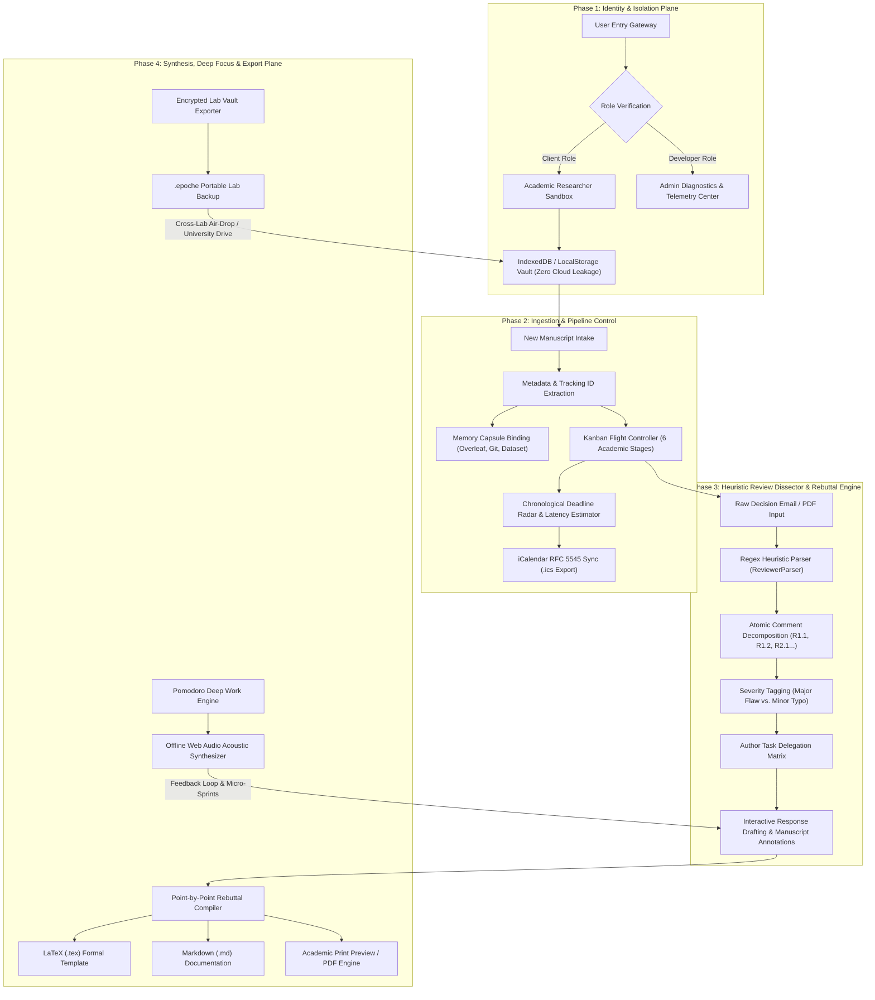
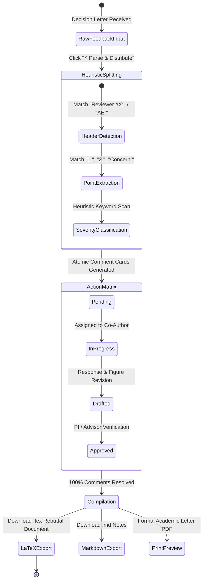

<div align="center">

# Epoché (Ἐποχή)
### *The Local-First Academic Submission Command, Peer-Review War Room & Anti-Amnesia Hub*

[](https://epoche-phi.vercel.app)
[](https://github.com/sepas1609/epoche)
[](https://github.com/sepas1609/epoche/releases/tag/v1.0.0)
[](LICENSE)
[](https://epoche-phi.vercel.app)

<br/>

**[🌐 Launch Live Web Application (epoche-phi.vercel.app)](https://epoche-phi.vercel.app)** • **[Documentation](#-core-architecture)** • **[Quickstart](#-quickstart--local-execution)** • **[Deployment](#-1-click-deployment)**

<br/>


</div>

---

## 🏛️ What is Epoché?

In classical Pyrrhonian philosophy and phenomenology, **Epoché** (pronounced *eh-poh-KAY*, from ancient Greek *ἐποχή*) denotes the deliberate **"suspension of judgment"**. 

This is the exact philosophical and operational state of a scientific manuscript under peer review: your findings and hypotheses are held in careful deliberation by the international academic community while awaiting judgment.

**Epoché** is an open-source, zero-knowledge flight-control dashboard built for university laboratories, research groups, graduate scholars, and interdisciplinary faculty submitting papers across international publishing houses (**IEEE, Elsevier, Springer Nature, ACM, OpenReview, arXiv**).

---

## ⚡ The Four Crises Epoché Solves

| Traditional Research Pain Point | The Reality | How Epoché Solves It |
| :--- | :--- | :--- |
| **1. The Single-Inbox Blindspot** | Journal editorial portals (ScholarOne, Editorial Manager, SNAPP) only email the primary corresponding author. Co-authors and graduate students remain blind to review updates unless forwarded manually. | **Unified Mission Control**: Centralizes status, manuscript tracking IDs, direct portal links, and co-author responsibilities on an open team canvas. |
| **2. Post-Submission Amnesia** | Academic peer review cycles take **3 to 9 months**. By the time decision letters arrive, authors forget which dataset version, simulation seed, or Git commit produced specific figures. | **Memory Capsules**: Permanently binds every paper to its exact Overleaf URL, Git branch + commit hash, Zenodo/Drive dataset snapshot, and lab bench notes. |
| **3. The Revision Panic Window** | Major revisions (30 days) and conference rebuttal windows (5–7 days) trigger cognitive paralysis when trying to dissect dense 5-page reviewer critiques into assigned tasks. | **Reviewer Comment Dissector**: Heuristic regex engine that parses unstructured review emails into atomic cards (`R1.1`, `R1.2`, `R2.1`) and generates LaTeX/Markdown response letters. |
| **4. Intellectual Property Leaks** | Unpublished research cannot be uploaded to commercial cloud platforms or untrusted servers without risking intellectual property breaches. | **Zero-Knowledge Client Storage**: 100% of manuscripts, comments, and keys reside strictly in the browser's `IndexedDB` & `localStorage`. Zero server footprint. |

---

## 📊 Core Architecture & Data Isolation



---

## ⚔️ Rebuttal Dissection & Reviewer Matrix Lifecycle



---

## 🌟 Modules & Capabilities

### 1. 🚀 Mission Control & Pipeline
* **6 Academic Stages**: `Drafting & Lab Prep` ➔ `Submitted & Queued` ➔ `Under Review` ➔ `Revision War Room` ➔ `Camera-Ready & Proofs` ➔ `Accepted & Published`.
* **Live Countdown Timers**: Real-time ticking down to the exact day/hour for revision and camera-ready cutoffs.
* **Panic Radar**: Automatic pulsing crimson warning alerts when deadlines drop under 7 days.
* **Quick-Delete Cards**: 1-click `🗑️` deletion directly on cards with instant pipeline recalculations.

### 2. ⚔️ Rebuttal War Room & Comment Dissector
* **Smart Reviewer Parser**: Paste unstructured decision emails; Epoché extracts individual remarks (`Reviewer 1 • Point 1`, `Reviewer 2...`) into actionable cards.
* **Co-Author Task Delegation**: Assign specific comments to specific lab members (e.g., *Hardware Oscilloscope Captures: Saran*, *Mathematical Proof: Dr. Rao*).
* **Publication-Grade Rebuttal Generator**: 1-click export of formal Point-by-Point Response documents in **LaTeX (`.tex`)**, **Markdown (`.md`)**, or **Print Preview / PDF** formatted for IEEE and Springer Nature editorial styles.

### 3. 🏛️ Journal Oracle & Editor Inquiry Kit
* **Portal Gateway Directory**: Quick links and typical turnaround benchmarks for **ScholarOne**, **Elsevier Editorial Manager**, **Springer Nature SNAPP**, **OpenReview**, **Microsoft CMT**, and **arXiv**.
* **EIC Inquiry Kit**: Pre-drafted, respectful academic letters with automatic variable interpolation:
  * *Courteous Status Inquiry (> 90 Days Under Review)*
  * *14-Day Revision Extension Request*
  * *Author Order & Affiliation Confirmation*
  * *Formal Manuscript Withdrawal Notice*
  * *Expedited Galley Proofs Clarification*

### 4. 🧠 Research Memory Capsules (Anti-Amnesia)
* Permanent anchors linking every paper to:
  * Clickable **Overleaf Project URL**
  * Exact **Git Commit Hash & Branch** (e.g., `commit 9f4b12c: zvt-boundary-ccm`)
  * **Dataset / Cloud Drive link** (Zenodo, Google Drive, HuggingFace)
  * **Lab bench configuration notes** (e.g., *MATLAB R2024b Simscape discrete solver at Ts=1e-6s, oscilloscope probe calibration*).

### 5. 🍅 Revision Sprint (ADHD & Deep Focus Mode)
* 25m / 50m Pomodoro sprint timer with SVG circular progress rings.
* **Offline Web Audio Acoustic Synthesizer**: Generates 10Hz Binaural Alpha Waves, Deep Brown Noise, and Synthetic Rain directly through browser audio nodes (zero external audio files or downloads).

### 6. 🛠️ Developer Console & Diagnostics
* **Storage Telemetry**: Real-time inspection of browser LocalStorage / IndexedDB byte consumption, proving zero external cloud leakage.
* **Active Session Inspector**: Displays session tokens, timestamps, and active permission scopes.
* **Raw JSON Ledger**: Live view and copy of the raw database records.
* **Mock Benchmark Controller**: 1-click injection of verified IEEE/Elsevier/ACM benchmark fixtures for demonstration, and instant storage purge for clean slates.

---

## 📊 Feature Comparison Matrix

| Feature | Epoché | Overleaf | Notion / Trello | Google Sheets | Zotero |
| :--- | :---: | :---: | :---: | :---: | :---: |
| **100% Zero-Knowledge Client Storage** | ✅ Yes | ❌ Cloud | ❌ Cloud | ❌ Cloud | ❌ Cloud Sync |
| **Reviewer Comment Auto-Dissector** | ✅ Yes | ❌ No | ❌ Manual | ❌ Manual | ❌ No |
| **Multi-Author Task Delegation Matrix** | ✅ Yes | ❌ No | ⚠️ Partial | ⚠️ Partial | ❌ No |
| **Point-by-Point LaTeX Rebuttal Exporter**| ✅ Yes | ⚠️ Manual | ❌ No | ❌ No | ❌ No |
| **Publisher Latency Benchmarks (IEEE/Elsevier)**| ✅ Yes | ❌ No | ❌ No | ❌ No | ❌ No |
| **Pre-written Editor-in-Chief Inquiry Kit**| ✅ Yes | ❌ No | ❌ No | ❌ No | ❌ No |
| **Memory Capsules (Overleaf + Git Anchors)**| ✅ Yes | ⚠️ Self | ⚠️ Manual | ⚠️ Manual | ❌ No |
| **Offline Web Audio Acoustic Synthesizer**| ✅ Yes | ❌ No | ❌ No | ❌ No | ❌ No |
| **1-Click RFC 5545 iCalendar (.ics) Sync** | ✅ Yes | ❌ No | ⚠️ Plugin | ❌ No | ❌ No |

---

## 🔒 Security & Privacy Invariants

Epoché operates under an absolute **Zero-Knowledge invariant**:
* **Origin-Isolated Persistence**: All data is saved in origin-isolated `localStorage` and `IndexedDB`.
* **Zero Cloud Telemetry**: Zero user papers, research notes, equations, or reviewer critiques ever leave your browser.
* **Encrypted Vault Portability**: Research data leaves your machine only when you explicitly export an `.epoche` vault file.

---

## 🚀 Quickstart & Local Execution

### Prerequisites
* **Node.js** (v18.0.0 or higher)
* **npm** (v9.0.0 or higher)

### Installation
```bash
# Clone the repository
git clone https://github.com/sepas1609/epoche.git
cd epoche

# Install dependencies
npm install

# Start local development server
npm run dev
```

Visit **`http://localhost:5173`** in your browser.

### Production Build
```bash
npm run build
npm run preview
```

---

## 🌐 1-Click Deployment

### Deploy to Vercel
Epoché includes a native [`vercel.json`](vercel.json) single-page configuration:

```bash
npx vercel
```

Or deploy instantly via the Vercel Dashboard:
1. Import repository: [`sepas1609/epoche`](https://github.com/sepas1609/epoche).
2. Framework Preset: **Vite**.
3. Output Directory: **`dist`**.
4. Click **Deploy**.

---

## 📄 Citation

If you use **Epoché** in your academic research laboratory or university department, please consider citing this project:

```bibtex
@software{boddu2026epoche,
  author       = {Boddu, Saran and Open Research Community},
  title        = {Epoché: The Local-First Academic Submission Command, Peer-Review War Room and Anti-Amnesia Hub},
  year         = {2026},
  publisher    = {GitHub},
  journal      = {GitHub repository},
  howpublished = {\url{https://github.com/sepas1609/epoche}},
  version      = {1.0.0}
}
```

---

## 📜 License

This project is licensed under the **MIT License** — see the [LICENSE](LICENSE) file for details.

Developed with ❤️ by **[Saran Boddu](https://github.com/sepas1609)** for researchers, graduate scholars, and interdisciplinary academic teams worldwide.
