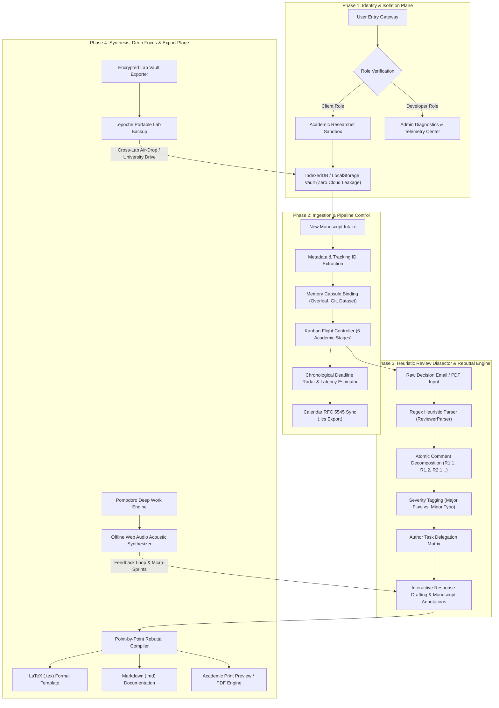

# Epoché (Ἐποχή)
> *The Local-First Academic Submission Command, Peer-Review War Room & Anti-Amnesia Hub*

[](LICENSE)


**Epoché** (pronounced *eh-poh-KAY*, from ancient Greek ἐποχή: *"suspension of judgment"*) is an open-source, zero-knowledge mission-control platform designed for university laboratories, research groups, and multi-domain academic teams submitting manuscripts across major international publishing houses (IEEE, Elsevier, Springer Nature, ACM, OpenReview, arXiv).

---

## 📊 Pipeline & System Architecture

The flowchart below visualizes the core architecture, client-side data flows, review dissection heuristics, and output synthesis pipelines of **Epoché**:



---

## 🔍 Abstract & Research Context

Multi-author academic research faces four systemic operational bottlenecks:
1. **The Single-Inbox Bottleneck**: Journal editorial systems (ScholarOne, Editorial Manager, SNAPP) only communicate with the corresponding author, leaving student co-authors and interdisciplinary collaborators blind to status shifts and review decisions.
2. **Post-Submission Cognitive Amnesia**: Long review cycles (3 to 9 months) sever working memory. When reviews return, authors have often forgotten which dataset version, simulation seed, or Git commit generated specific figures.
3. **The Revision Panic Window**: Intense rebuttal windows (5–7 days for conferences, 30 days for IEEE/Elsevier major revisions) overwhelm teams attempting to parse dense 5-page reviewer reports into assigned tasks.
4. **Confidentiality & Academic Ethics**: Unpublished research cannot be uploaded to third-party commercial cloud databases without risking intellectual property breaches.

**Epoché** resolves this through an **offline-capable, zero-knowledge client-first web architecture**:
* All manuscripts, reviewer criticisms, and rebuttal matrices remain strictly inside the user's browser memory (`IndexedDB` & `localStorage`).
* Zero bytes of proprietary research data ever leak to external cloud servers.
* Teams exchange data securely via encrypted `.epoche` vault exports or self-hosted Git repositories.

---

## 🌟 Core Modules

| Module | Purpose | Key Capabilities |
| :--- | :--- | :--- |
| **🚀 Mission Control** | Submission flight control | 6-stage Kanban board, real-time revision countdowns, 7-day panic alarms, publisher latency benchmarks. |
| **⚔️ Rebuttal War Room** | Reviewer criticism breakdown | Smart regex parser that auto-splits raw decision emails into atomic cards, team assignment matrix, point-by-point progress bar. |
| **📄 Publication Exporter** | Formal rebuttal creation | 1-click generation of camera-ready **LaTeX (`.tex`)**, **Markdown (`.md`)**, and academic **Print Preview** response letters. |
| **🏛️ Journal Oracle** | Platform directory & diplomacy | Directory of global publisher portals (IEEE, Elsevier, Springer) with polite Editor-in-Chief correspondence generators. |
| **🧠 Memory Capsules** | Anti-amnesia checkpoints | Permanent anchors linking papers to exact Overleaf projects, Git commit hashes, dataset drives, and hardware notes. |
| **🍅 Revision Sprint** | ADHD & deadline crunch mode | 25m/50m deep work Pomodoro with offline Web Audio acoustic synthesizer (10Hz Binaural Alpha Waves, Brown Noise, Rain). |
| **🛠️ Developer Console** | Admin telemetry & diagnosis | Storage quota inspector, active permission scopes, raw JSON database viewer, and 1-click test benchmark injection. |

---

## 📁 Repository Structure

```
epoche/
├── index.html                   # Semantic HTML5 Application Shell & Dialogs
├── package.json                 # Project dependencies & Vite scripts
├── vercel.json                  # Vercel SPA deployment configuration
├── .gitignore                   # Standard node & build artifact exclusions
├── public/
│   └── hero-banner.jpg          # Holographic Research Command Visual Asset
└── src/
    ├── style.css                # Midnight Obsidian glassmorphism design system
    ├── main.js                  # Application controller, state sync & event loops
    ├── data/
    │   └── seedData.js          # Verified benchmark research fixtures & portal metadata
    └── services/
        ├── auth.js              # Client vs. Developer Role-Based Access Control (RBAC)
        ├── storage.js           # Zero-knowledge IndexedDB engine & .epoche vault export
        ├── parser.js            # Smart regex reviewer comment auto-dissector
        ├── rebuttalGenerator.js # Publication-grade LaTeX, Markdown, & HTML rebuttal generator
        ├── inquiryTemplates.js  # Courteous Editor-in-Chief correspondence letter templates
        └── audio.js             # Offline Web Audio API binaural & noise acoustic synthesizer
```

---

## 🚀 Setup and Local Execution

### Prerequisites
* **Node.js** (v18.0.0 or higher)
* **npm** (v9.0.0 or higher)

### Installation
1. Clone this repository:
   ```bash
   git clone https://github.com/sepas1609/epoche.git
   cd epoche
   ```

2. Install dependencies:
   ```bash
   npm install
   ```

3. Launch local development server:
   ```bash
   npm run dev
   ```
   Open **`http://localhost:5173`** in your browser.

4. Build production bundle:
   ```bash
   npm run build
   ```

---

## 🌐 Deploying to Vercel (1-Click & CLI)

Epoché is pre-configured with [`vercel.json`](vercel.json) for instant deployment:

### Option 1: Via Vercel CLI
```bash
npx vercel
```
* Follow the CLI prompt to select your scope.
* Vercel will detect Vite automatically and deploy directly.

### Option 2: Via Vercel Web Dashboard
1. Navigate to [vercel.com/new](https://vercel.com/new).
2. Import the GitHub repository: `sepas1609/epoche`.
3. Vercel automatically configures:
   * **Framework Preset:** `Vite`
   * **Build Command:** `npm run build`
   * **Output Directory:** `dist`
4. Click **Deploy** for a permanent, free `epoche.vercel.app` production deployment with global CDN and SSL.

---

## 🔒 Security & Privacy Model

Epoché operates under an absolute **Zero-Knowledge invariant**:
* **Client-Only Persistence**: All data is stored in the browser's origin-isolated `localStorage` and `IndexedDB`.
* **No Telemetry Leakage**: No user manuscripts, research hypotheses, or reviewer critiques are transmitted to external analytics or LLM servers.
* **Portable Vaults**: Research data leaves your machine only when you explicitly export an `.epoche` vault file.

---

## 📄 License & Attribution

This project is licensed under the **MIT License** — see the [LICENSE](LICENSE) file for details.

Developed with ❤️ for academic researchers, graduate scholars, and interdisciplinary scientific teams worldwide.
